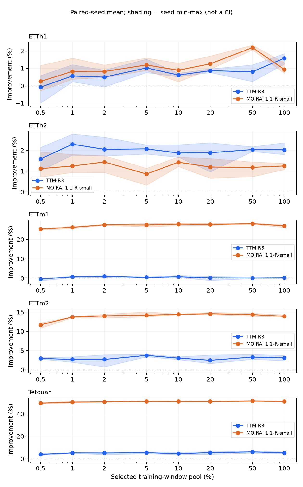

# Zero-shot to few-shot crossover in time-series foundation models

[한국어](README.md) · [Result tables](results/paper/tables.md) · [Reproduction guide](docs/reproducibility.md)

How many training windows does a time-series foundation model need before fine-tuning consistently improves on zero-shot forecasting? We compare TTM-R3 and MOIRAI 1.1-R-small across increasing training-window pools under a fixed update budget. The repository provides the experiment code and saved metrics for 270 final-test conditions.

## Findings

- **Mean error across seeds.** All ten model–dataset combinations improved by the time the pool reached 1%, with gains sustained at every larger measured fraction.
- **Improvement in all three seeds.** Nine of ten combinations met this criterion by 5%. TTM–ETTm1 did not meet it on the measured grid.
- **Final error.** At the 100% pool, TTM had lower mean NMAE on all five datasets.



Lines show the mean relative improvement across seeds. Shading spans the smallest and largest seed-level improvements. [Crossover intervals and errors](results/paper/tables.md) · [Saved metrics CSV](results/public/conditions.csv)

## Experiment design

| Setting | Value |
| --- | --- |
| Models | IBM Granite TTM-R3 and Salesforce MOIRAI 1.1-R-small |
| Datasets | ETTh1, ETTh2, ETTm1, ETTm2, Tetouan |
| Split and forecast | Chronological 60/20/20 split, 512 input steps, 96 forecast steps |
| Conditions | Zero-shot plus eight fine-tuning fractions (0.5%–100%), three seeds per condition |
| Budget and metric | Up to 1,000 updates, NMAE (mean of per-channel MAE normalized by training standard deviation) |

The crossover interval marks the first measured improvement that persists at every larger measured fraction. Fractions refer to the pool of eligible training windows. The update cap also applies at 100%. The findings are specific to the models, datasets, horizon, and budget evaluated here. [Full protocol](docs/final-protocol.md)

## Reproduce the tables and figure

Python 3.12 is recommended. Activate a virtual environment, then run the following from the repository root. This uses the saved evaluation metrics and runs on CPU.

```bash
python -m pip install -r requirements/analysis.txt
python -m tsfm_crossover.analysis.public_results --output outputs/paper-reproduction
```

Choose a new output path to generate the tables, figure, and seed-level improvements. [Analyze results in Colab](https://colab.research.google.com/github/Youseung-Han/tsfm-zero-few-shot-crossover/blob/main/notebooks/50_results_analysis.ipynb) · [Model reruns and data setup](docs/reproducibility.md) · [Software citation](CITATION.cff)
