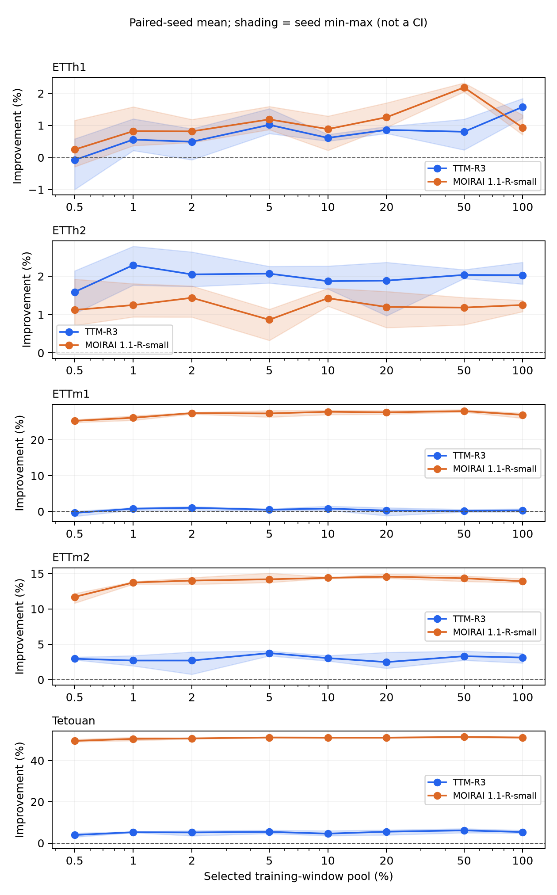

# TSFM Zero-Shot–Few-Shot Crossover

[한국어](README.md) · [Reproduction](docs/reproducibility.md) · [Protocol](docs/final-protocol.md) · [Data](docs/data-preparation.md) · [Schema](docs/public-result-schema.md)

Code and saved results for **Zero-Shot to Few-Shot Crossover in Time-Series Foundation Models under a Bounded Fine-Tuning Budget**. We study when fine-tuning first beats zero-shot and remains better at every larger measured training-window fraction under a fixed update budget.

## Results

We provide **270 original-precision final-test conditions**, extracted from actual execution records rather than rounded paper values. [Tables 1 and 2](results/paper/tables.md) and the [comparison report](results/paper/verification.json) are reproducible.

- All ten model–dataset combinations meet the mean sustained criterion by 1%.
- Seven meet the all-three-seed criterion at (0, 0.5]%; MOIRAI–ETTh1 at (0.5, 1]%; TTM–ETTh1 at (2, 5]%. TTM–ETTm1 does not meet it on the measured grid.
- Mean paired improvement at the 100% pool is 0.31–5.38% for TTM and 0.93–51.17% for MOIRAI.
- Improvement and final error are different: TTM has lower mean final NMAE on all five datasets at the 100% pool.



Lines show mean paired-seed improvement. Shading is seed min–max, **not a confidence interval**. Segments connect measurements; intervals are not exact continuous thresholds.

## Experiment

| Setting | Value |
|---|---|
| Models | TTM-R3; MOIRAI 1.1-R-small |
| Data | ETTh1, ETTh2, ETTm1, ETTm2, Tetouan |
| Temporal split / context / horizon | 60/20/20 / 512 / 96 |
| Window-pool fractions | 0.5, 1, 2, 5, 10, 20, 50, 100%, plus zero-shot |
| Seeds / conditions | 1729, 2718, 31415 / 270 |
| Sampling | Nested temporal-stratified prefixes; shared across models for each seed |
| Training | FP32, all parameters, batch 1, at most 1,000 updates |
| Validation | Fixed 64 windows every 100 updates, patience 3, best validation checkpoint |
| Learning rates | TTM 1e-4; MOIRAI 5e-6 |
| Primary metric | Channel MAE divided by train population standard deviation, then averaged |

0.5% means selected windows across the **entire training period**, not collecting 0.5% of that period. A 100% candidate pool does not imply a complete epoch or convergence. ETT hourly/minute variants share two transformer sources; all five datasets form three source groups.

## Quick start: CPU result analysis

Python 3.12 is recommended. Run from the repository root:

```bash
git clone https://github.com/Han-Youseung/tsfm-zero-few-shot-crossover.git
cd tsfm-zero-few-shot-crossover
python -m venv .venv
# Activate: source .venv/bin/activate
# PowerShell: .venv/Scripts/Activate.ps1
python -m pip install -r requirements/analysis.txt
python -m tsfm_crossover.analysis.public_results --output outputs/paper-reproduction
```

No GPU, original datasets or weights are required. Outputs include Tables 1/2, Figure 1, paired improvements and missing-condition coverage. Use a new output directory. See [reproduction](docs/reproducibility.md) for the distinction between saved-metric analysis and model reruns.

## Colab

- [CPU result analysis](https://colab.research.google.com/github/Han-Youseung/tsfm-zero-few-shot-crossover/blob/main/notebooks/50_results_analysis.ipynb)
- [Minimal TTM–ETTh1 example](https://colab.research.google.com/github/Han-Youseung/tsfm-zero-few-shot-crossover/blob/main/notebooks/51_minimal_ttm_etth1.ipynb)

The minimal notebook defaults to a smoke with 2 updates, 4 validation windows and 8 test windows. Its metrics cannot be compared directly with the paper. The complete paper contains 270 conditions.

## Model reproduction

Use separate Python 3.12/Linux CUDA environments for the models. Check [versions](docs/versions.md) and [data preparation](docs/data-preparation.md).

```bash
python -m pip install -r requirements/ttm-main.txt
python scripts/prepare_study_data.py --dataset ETTh1
python scripts/reproduce_paper.py --scope pair --output outputs/pair
python scripts/reproduce_paper.py --scope pair --output outputs/pair --execute
```

The pair is TTM–ETTh1, seed 1729, zero-shot and 0.5%. For the complete experiment, prepare all five datasets and run each family in its own environment:

```bash
python scripts/reproduce_paper.py --scope full --family ttm --output outputs/full-ttm --execute
python scripts/reproduce_paper.py --scope full --family moirai1 --output outputs/full-moirai1 --execute
```

Each family has 135 conditions. The original engine, strict runtime checks and checkpoint resume are retained. Original configuration metadata includes a broader historical plan; use these wrappers for the final paper subset. See [validation](docs/verification.md) for what has actually been executed.

## Result explorer

```bash
python -m pip install -r requirements.txt
python app.py
```

Open http://127.0.0.1:7860. Inspect model/dataset choices, paired seed and mean improvements, actual zero-shot/fine-tuned NMAE, both sustained intervals and downloadable results. The app reads saved CSV and performs no live inference. [Spaces deployment](docs/deployment.md) is prepared; a hosted URL will be added after deployment.

## Layout

| Path | Content |
|---|---|
| src/tsfm_crossover | Data, official model adapters, training, evaluation and analysis |
| scripts | Data preparation, final-subset execution, import and verification |
| notebooks | CPU analysis and minimal model example |
| configs | Original execution settings and final analysis scope |
| results/public | 270 conditions, model/environment metadata and checksums |
| results/paper | Regenerated paper tables and figure |
| results/manifests | Required pinned model, data and result evidence |
| docs | Reproduction, protocol, sources, schema and verification |
| tests | Aggregation boundaries and execution contracts |
| spaces | Space metadata |

## Limitations, citation and rights

This is descriptive evidence for three seeds, three source groups, H96, a bounded budget and a scope finalized after results were available. Pretraining overlap was not audited. Overlapping rolling origins are not independent samples. We do not claim universal model superiority or measured operational/data-collection benefits.

The implementation independently uses official TTM/MOIRAI APIs. TSFM-Bench is related work only. See [references](docs/references.bib), [provenance](docs/provenance.md) and [CITATION.cff](CITATION.cff).

The supplied final PDF does not identify authors, affiliations, venue, publication status or DOI. Existing Git history identifies software contributor 한유승; coauthors and research roles remain unconfirmed. CFF cites software, not a published paper. Include the exact commit and CSV SHA-256 when citing results.

No project license is specified. Public visibility is not a license grant. Model/data/code rights are separate. Raw data, weights and personal logs are not distributed.
