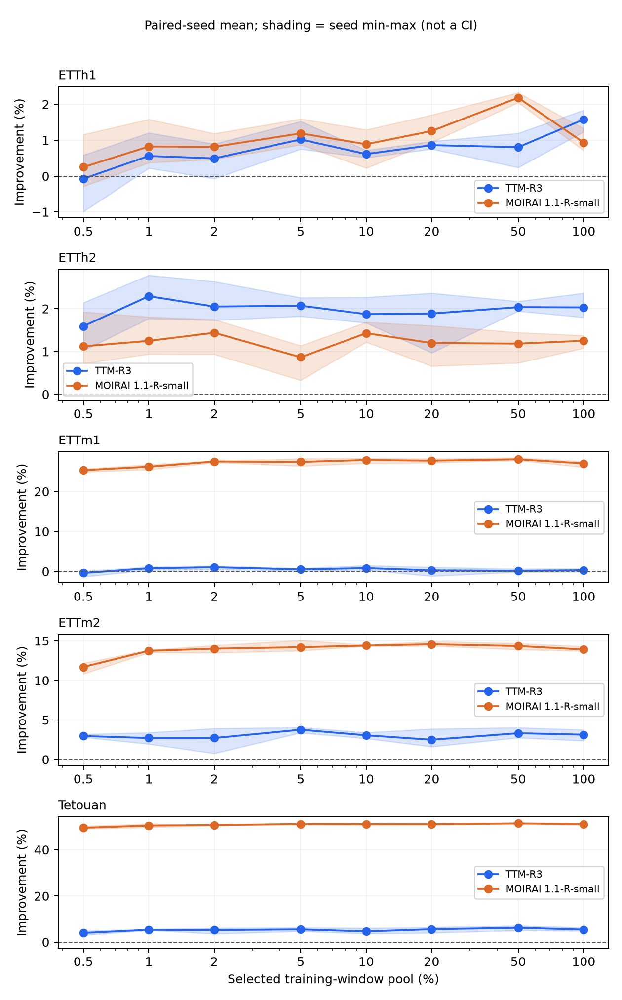

# 시계열 파운데이션 모델의 제로샷·퓨샷 성능 전환 구간 분석

[English](README.en.md) · [논문 결과표](results/paper/tables.md) · [재현 안내](docs/reproducibility.md)


시계열 파운데이션 모델을 미세조정할 때, 학습 윈도를 얼마나 확보하면 제로샷 예측보다 꾸준히 나아질까? TTM-R3와 MOIRAI 1.1-R-small을 대상으로, 학습 업데이트 예산을 고정하고 미세조정에 사용할 수 있는 윈도 비율을 바꿔 비교했다. 이 저장소에는 실험 코드와 최종 평가 270조건의 결과가 있다.

## 핵심 결과

| 판정 기준 | 관측 결과 |
| --- | --- |
| 시드 3개의 평균 상대 개선율 | 모델·데이터셋 10개 조합 모두 **1% 이하**에서 지속 개선 |
| 시드 3개 각각의 상대 개선율 | 10개 중 **9개 조합이 5% 이하**에서 지속 개선. 이 중 7개는 가장 작은 측정 비율인 0.5%부터 기준 충족 |

**데이터를 늘리자 일부 반복에서 개선이 사라진 경우도 있었다.** TTM–ETTm1은 1~10%에서 시드 3개 모두의 오차가 낮아졌지만, 20% 이상 조건에서 일부 시드의 오차가 제로샷보다 커져 세 시드 지속 개선 기준을 충족하지 못했다.

**소량의 데이터에서 큰 개선이 나타난 사례도 있었다.** MOIRAI–Tetouan은 학습 윈도 154개(0.5%)만으로 제로샷 대비 NMAE가 평균 **49.5%** 감소했다. 같은 조합에서 후보 풀 전체를 허용했을 때의 감소율은 **51.2%**였다. 100% 조건의 최종 평균 NMAE는 다섯 데이터셋 모두에서 TTM이 더 낮았다. 제로샷 대비 개선 폭과 미세조정 후 최종 오차는 각각 모델 적응 효과와 예측 정확도를 보여준다.



실선은 시드 3개의 평균 상대 개선율이고, 음영은 최솟값부터 최댓값까지의 범위다. 0보다 크면 미세조정 후 오차가 감소한 것이다. 패널마다 세로축 범위가 다르다. [조합별 전환 구간과 오차](results/paper/tables.md) · [270개 평가 결과 CSV](results/public/conditions.csv)

## 실험 설계

| 항목 | 설정 |
| --- | --- |
| 모델 | IBM Granite TTM-R3(MLP 기반), Salesforce MOIRAI 1.1-R-small(Transformer 기반) |
| 데이터셋 | ETTh1·ETTh2(1시간), ETTm1·ETTm2(15분), Tetouan(10분) |
| 예측 과제 | 과거 512개 시점으로 이후 96개 시점의 모든 변수를 예측 |
| 데이터 분할 | 시간순 학습 60% / 검증 20% / 시험 20%. 모든 조건에서 같은 시험 윈도로 평가 |
| 비교 조건 | 제로샷 + 미세조정 8개 비율(0.5, 1, 2, 5, 10, 20, 50, 100%). 모델 2개 × 데이터셋 5개 × 비교 조건 9개 × 시드 3개 = 총 270개 평가 |
| 미세조정 예산 | 조건별 최대 1,000회 업데이트. 검증 오차가 가장 낮은 체크포인트를 시험에 사용 |
| 평가 지표 | NMAE. 변수별 MAE를 학습 구간의 해당 변수 표준편차로 나눈 뒤 평균 |

**학습 윈도 비율.** 입력 512개 시점과 정답 96개 시점이 모두 학습 구간에 들어오는 윈도를 한 시점씩 옮기며 만들었다. 비율은 이 후보 풀에서 미세조정에 사용할 수 있도록 선택한 윈도의 비중이다. 0.5%는 ETTh 데이터셋당 49개, ETTm 데이터셋당 206개, Tetouan은 154개다. 윈도를 학습 기간 전체에서 골고루 뽑고 작은 비율의 윈도가 큰 비율에도 포함되도록 했다. 두 모델에 동일한 시드와 비율에서는 같은 윈도를 제공했다.

**전환 구간 판정.** 제로샷보다 오차가 낮고, 이후 측정한 모든 더 큰 비율에서도 개선이 유지되기 시작한 첫 비율을 찾았다. 예를 들어 개선이 5%부터 계속 유지되고 직전 측정점이 2%라면 전환 구간은 `(2%, 5%]`로 표기한다. 판정은 시드별 개선율의 평균과 시드 3개 각각에 적용했다.

**해석 범위.** 100%는 후보 풀 전체를 허용한다는 뜻이며, 이 조건에도 최대 1,000회 업데이트를 적용했다. ETT 네 변형은 두 변압기의 기록을 서로 다른 간격으로 기록한 데이터이며, Tetouan을 포함해 원천은 세 곳이다. 관측한 전환 구간은 두 모델과 다섯 데이터셋, 96스텝 예측, 해당 학습 예산에 한정된다. [상세 실험 프로토콜](docs/final-protocol.md)

## 결과 재현

기존 실험 결과로 표와 그림을 다시 만드는 데는 Python 3.12를 권장한다. GPU와 모델 가중치가 필요 없다. 가상환경을 활성화한 뒤 저장소 루트에서 다음을 실행한다.

```bash
python -m pip install -r requirements/analysis.txt
python -m tsfm_crossover.analysis.public_results --output outputs/paper-reproduction
```

새 출력 경로를 지정하면 표·그림과 시드별 개선율이 생성된다. [Colab에서 결과 분석](https://colab.research.google.com/github/Youseung-Han/tsfm-zero-few-shot-crossover/blob/main/notebooks/50_results_analysis.ipynb) · [모델 재실행 및 데이터 준비](docs/reproducibility.md) · [인용 정보](CITATION.cff)
