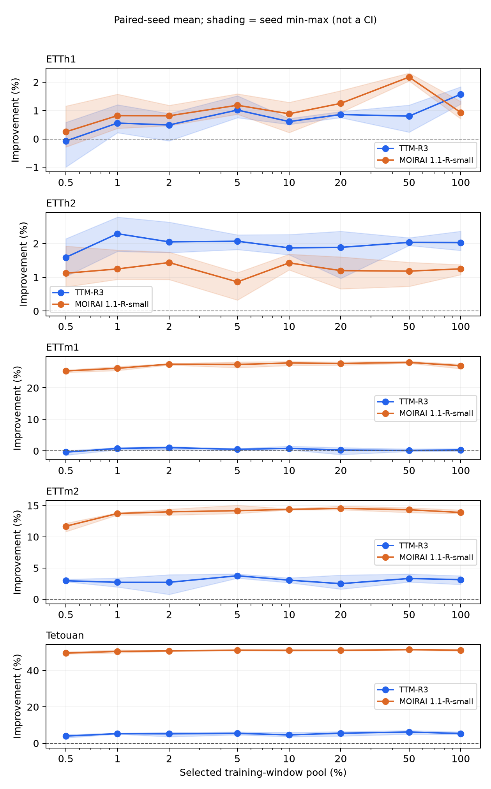

# TSFM Zero-Shot–Few-Shot 성능 전환 구간

[English](README.en.md) · [재현 안내](docs/reproducibility.md) · [프로토콜](docs/final-protocol.md) · [데이터](docs/data-preparation.md) · [결과 스키마](docs/public-result-schema.md)

**제한된 미세조정 예산에서 시계열 파운데이션 모델의 Zero-Shot-Few-Shot 성능 전환 구간 분석**의 연구 코드와 실험 결과입니다. TTM-R3와 MOIRAI 1.1-R-small에서 학습 윈도 후보 풀을 늘릴 때, 미세조정이 Zero-Shot보다 좋아지고 더 큰 측정 비율에서도 그 개선을 유지하는 구간을 분석합니다.

## 주요 결과

최종 시험 결과 **270조건**을 제공합니다. 논문의 반올림 값을 옮긴 자료가 아니라 실제 실행 기록에서 추출한 원 정밀도 metric입니다. [표 1·표 2](results/paper/tables.md)와 [수치 대조 결과](results/paper/verification.json)를 확인할 수 있습니다.

- 평균 기준에서는 10개 모델–데이터 조합 모두 1% 이하에서 지속 개선했습니다.
- 모든 3seed 기준에서는 7개가 (0, 0.5]%, MOIRAI–ETTh1이 (0.5, 1]%, TTM–ETTh1이 (2, 5]%였습니다. TTM–ETTm1은 관측 격자에서 기준을 충족하지 못했습니다.
- 100% 후보 풀의 평균 paired 개선율은 TTM 0.31–5.38%, MOIRAI 0.93–51.17%였습니다.
- 개선 폭과 최종 오차는 별개입니다. 100% 후보 풀의 평균 NMAE는 다섯 데이터 모두 TTM이 더 낮았습니다.



실선은 seed별 상대 개선율의 평균, 음영은 **seed 최소–최대 범위**입니다. 신뢰구간이 아닙니다. 선분은 관측점을 연결하며, 표시 구간은 정확한 연속 전환점을 뜻하지 않습니다.

## 실험 설정

| 항목 | 설정 |
|---|---|
| 모델 | TTM-R3, MOIRAI 1.1-R-small |
| 데이터 | ETTh1, ETTh2, ETTm1, ETTm2, Tetouan |
| 분할 / 입력 / 예측 | 시간순 60/20/20 / 512 / 96 |
| 학습 후보 풀 | 0.5, 1, 2, 5, 10, 20, 50, 100% + Zero-Shot |
| seed / 총 조건 | 1729, 2718, 31415 / 270 |
| 표본 | 시간층화 중첩 표본, 같은 seed에서 모델 간 동일 표본 |
| 학습 | FP32, 전체 파라미터, batch 1, 최대 1,000 updates |
| 검증 | 고정 64윈도, 100 updates마다, patience 3, best validation checkpoint |
| 학습률 | TTM 1e-4 / MOIRAI 5e-6 |
| 주지표 | 채널별 MAE를 train population std로 나눈 뒤 평균한 NMAE |

**0.5%는 학습 기간 전체에서 선택한 윈도 후보 비율**입니다. 관측 기간 0.5%만 수집했다는 뜻이 아닙니다. 100%는 후보 풀 전체를 허용한다는 뜻이며 전체 순회나 수렴을 뜻하지 않습니다. ETT 네 변형은 두 변압기 출처를 공유하므로 전체 출처군은 세 개입니다.

## 빠른 시작: 저장 결과 분석

Python 3.12를 권장합니다. 저장소 루트에서 실행합니다.

```bash
git clone https://github.com/Han-Youseung/tsfm-zero-few-shot-crossover.git
cd tsfm-zero-few-shot-crossover
python -m venv .venv
# Linux/macOS: source .venv/bin/activate
# Windows PowerShell: .venv/Scripts/Activate.ps1
python -m pip install -r requirements/analysis.txt
python -m tsfm_crossover.analysis.public_results --output outputs/paper-reproduction
```

GPU·원 데이터·가중치 없이 표 1, 표 2, 그림 1, seed별 개선율, 누락 현황을 생성합니다. 출력 폴더는 새 이름이어야 합니다. 저장 metric 재집계와 모델 재실행은 [재현 안내](docs/reproducibility.md)에서 구분합니다.

## Colab

- [결과 분석 — GPU 불필요](https://colab.research.google.com/github/Han-Youseung/tsfm-zero-few-shot-crossover/blob/main/notebooks/50_results_analysis.ipynb)
- [TTM–ETTh1 최소 모델 예제](https://colab.research.google.com/github/Han-Youseung/tsfm-zero-few-shot-crossover/blob/main/notebooks/51_minimal_ttm_etth1.ipynb)

최소 모델 예제는 기본 smoke 모드입니다. 2 updates, validation 4윈도, test 8윈도로 축소하므로 논문 수치와 직접 비교할 수 없습니다. 전체 논문은 270조건입니다.

## 모델 재현

모델마다 별도 Python 3.12/Linux CUDA 환경을 사용합니다. [고정 버전](docs/versions.md)과 [데이터 준비](docs/data-preparation.md)를 먼저 확인하세요.

```bash
python -m pip install -r requirements/ttm-main.txt
python scripts/prepare_study_data.py --dataset ETTh1
# TTM–ETTh1, seed 1729, ZS와 0.5%의 2조건 계획
python scripts/reproduce_paper.py --scope pair --output outputs/pair
# 호환 GPU와 깨끗한 checkout에서 실행
python scripts/reproduce_paper.py --scope pair --output outputs/pair --execute
```

전체 실험은 다섯 데이터 준비 후 각 모델 환경에서 실행합니다.

```bash
python scripts/reproduce_paper.py --scope full --family ttm --output outputs/full-ttm --execute
python scripts/reproduce_paper.py --scope full --family moirai1 --output outputs/full-moirai1 --execute
```

각 모델은 135조건입니다. 원본 학습·평가 엔진의 runtime 검증과 checkpoint 재개를 사용합니다. 원 실행 설정에는 더 넓은 과거 계획이 보존되어 있으므로, 최종 논문 범위 실행에는 위 진입점을 사용합니다. GPU 재실행 검증 범위는 [검증 문서](docs/verification.md)를 확인하세요.

## 결과 탐색 데모

```bash
python -m pip install -r requirements.txt
python app.py
```

[로컬 앱](http://127.0.0.1:7860)에서 모델·데이터를 선택하고 seed별/평균 개선율, 실제 ZS·FT NMAE, 두 지속 개선 구간과 결과 다운로드를 확인할 수 있습니다. 실시간 모델 추론 없이 공개 CSV를 읽습니다. Hugging Face Spaces용 파일과 [배포 절차](docs/deployment.md)를 제공합니다. 호스팅된 Space 주소는 배포 후 추가합니다.

## 저장소 구조

| 경로 | 내용 |
|---|---|
| src/tsfm_crossover/ | 데이터·공식 모델 adapter·학습·평가 및 분석 코드 |
| scripts/ | 데이터 준비, 최종 실험 실행, 결과 집계·검증 |
| notebooks/ | 결과 분석 / 최소 모델 예제 두 가지 |
| configs/ | 원 실행 설정과 최종 분석 범위 |
| results/public/ | 270조건 CSV, 모델·환경·출처·체크섬 |
| results/paper/ | 재생성 표 1·표 2·그림 1 |
| results/manifests/ | 재현에 필요한 고정 모델·데이터·실험 근거 |
| docs/ | 재현 방법·프로토콜·출처·스키마·검증 |
| tests/ | 집계 경계 사례와 데이터·모델 실행 계약 테스트 |
| spaces/ | Hugging Face Spaces 메타데이터 |

## 한계·인용·권리

seed 3개, 출처군 3개, H96, 제한된 학습 예산과 사후 확정 범위의 기술적 분석입니다. 사전학습 중복은 감사하지 않았습니다. 겹치는 rolling origins를 독립 표본으로 취급하지 않으며, 모든 시계열·모델·예산으로 일반화하지 않습니다. 실제 수집 비용이나 운영 성과를 측정한 연구가 아닙니다.

공식 TTM·MOIRAI 구현과 공개 API를 사용한 독립 구현입니다. TSFM-Bench는 관련 문헌으로만 참고했습니다. [참고문헌](docs/references.bib), [원 결과 출처](docs/provenance.md), [CITATION.cff](CITATION.cff)를 제공합니다.

논문 영문 제목은 *Zero-Shot to Few-Shot Crossover in Time-Series Foundation Models under a Bounded Fine-Tuning Budget*입니다. 제공된 최종 PDF에 저자·소속·게재 상태·DOI가 표시되지 않아 출판정보는 기재하지 않았습니다. 저장소 Git 작성자명은 한유승이며 공동저자·연구 역할별 기여는 확인되지 않았습니다. CFF는 소프트웨어 인용이며 사용한 commit과 CSV SHA-256을 함께 기록하세요.

프로젝트 라이선스는 아직 지정되지 않았습니다. 공개 가시성을 이용 허락으로 간주하지 마세요. 원모델 코드·가중치·데이터의 권리는 별도로 적용됩니다. 원 데이터·가중치·개인 로그는 배포하지 않습니다.
